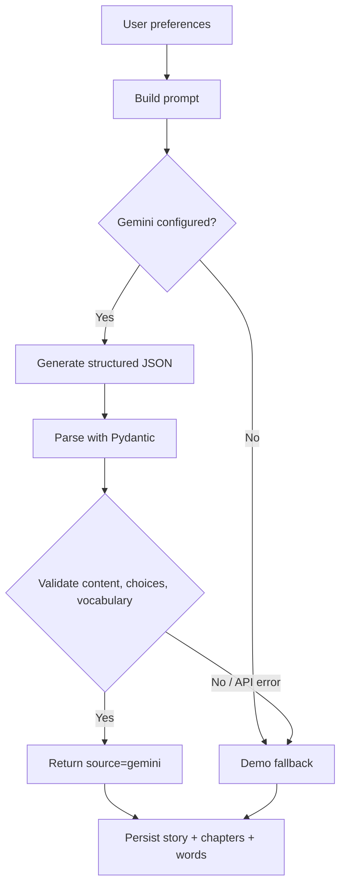

# AI Engine: thiết kế và luồng xử lý

## Thành phần

- `backend/ai_engine/prompts.py`: xây prompt tạo chương đầu và chương tiếp theo; yêu cầu đầu ra JSON, độ khó CEFR, từ vựng và tính nhất quán của truyện.
- `backend/ai_engine/schemas.py`: Pydantic schema `FirstChapter`, `NextChapter`.
- `backend/app/services/story_service.py`: Gemini client, parse JSON, validation, xử lý lỗi và fallback.
- `backend/app/services/demo_story.py`: nội dung dự phòng khi không có AI.

## Pipeline

## Validation

`_parse_json()` thử JSON nguyên bản, fenced JSON và phần JSON object trong văn bản. `_validate_first()` yêu cầu nội dung không rỗng, ít nhất hai lựa chọn, lọc từ trùng, yêu cầu từ có nghĩa và xuất hiện trong nội dung. Chương tiếp theo yêu cầu ít nhất hai lựa chọn, trừ chương cuối. Khi AI trả dữ liệu không hợp lệ, service thử lại với cách cấu hình response khác trước khi fallback.

## Các biến cấu hình

| Biến | Mặc định | Ý nghĩa |
|---|---|---|
| `GEMINI_API_KEY` | trống | Trống = demo |
| `GEMINI_MODEL` | `gemini-2.5-flash` | Model gọi qua SDK |
| `GEMINI_BACKEND` | `auto` | `studio` / `vertex` / `auto` |
| `GEMINI_TIMEOUT_SECONDS` | `45` | Timeout một Gemini call |
| `GENERATE_LIMIT_PER_HOUR` | `10` | Số truyện mới/user/giờ, 0 = không giới hạn |

## Chẩn đoán

- `GET /health/ai`: trạng thái client và thông báo lỗi gần nhất.
- `GET /health/ai?probe=true`: thử kết nối AI thực, có thể phát sinh quota/chi phí.
- Story response có `fallback_reason`; `source` trong bảng stories giúp phân biệt AI và demo.

## Giới hạn và cải tiến

AI có thể trả dữ liệu thiếu, sai định dạng hoặc hết quota; fallback không phải bằng chứng Gemini hoạt động. Không bảo đảm đầu ra luôn phù hợp sư phạm. Nên thêm đánh giá chất lượng nội dung, kiểm soát chi phí, logging không lộ dữ liệu nhạy cảm, và test nhiều ngôn ngữ/trình độ.
