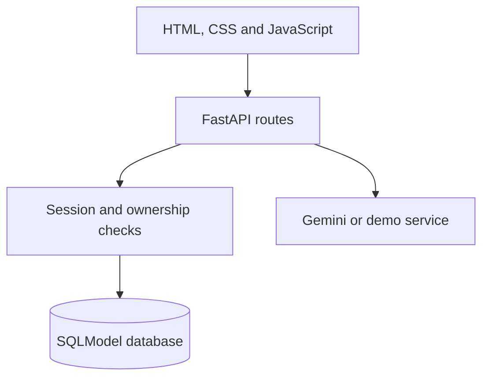
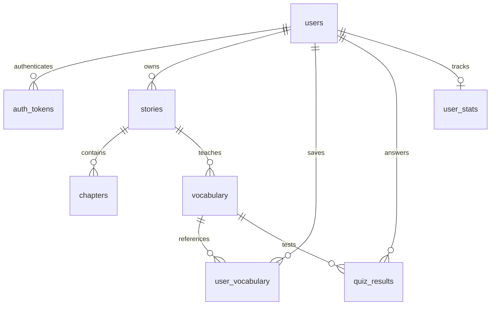

# Architecture — AI StoryLingo

## Request boundaries

`frontend/api.js` attaches the Bearer session to requests. Routes use the shared `protect_learning` dependency, so supplying a user ID alone never authorizes access. `admin_user` additionally checks the role stored in the database. Account data in localStorage is only a cached display profile; startup verifies the session with `/auth/me`.

## Authentication

| Endpoint | Purpose | Access |
|---|---|---|
| POST `/auth/register` | Validate name/email/password/terms and create a learner session | Public, throttled |
| POST `/auth/login` | Verify bcrypt password and issue a session | Public, throttled |
| GET `/auth/me` | Read the authenticated profile | Bearer |
| POST `/auth/logout` | Revoke current session | Bearer |
| GET `/auth/config` | Public Google Client ID and recovery availability | Public |
| GET `/auth/google/nonce` | Issue a short-lived Google challenge | Public, throttled |
| POST `/auth/google` | Verify Google identity and issue an application session | Verified Google token + nonce |
| POST `/auth/forgot-password` | Send a 15-minute reset link through SMTP | Public, throttled |
| POST `/auth/reset-password` | Consume the reset token and revoke old sessions | One-time reset token |
| GET `/admin/overview` | Aggregate workspace counts | Admin Bearer |
| GET `/admin/users` | Paginated account directory | Admin Bearer |

Sessions are random opaque tokens. The database stores SHA-256 digests, purpose, expiry and user reference. Session plaintext is returned only at issuance and kept in the browser tab's sessionStorage. Passwords remain bcrypt hashes. Google accounts use the provider's `sub`; matching emails are not automatically linked.

## Learning API

| Endpoint | Responsibility |
|---|---|
| POST `/stories/generate` | Validate story settings, check quota, generate and save chapter/vocabulary |
| POST `/stories/{id}/next-chapter` | Validate ownership and offered choice; generate the next chapter |
| GET `/stories/history/{user_id}` | Paginated story summaries |
| GET `/stories/{id}?user_id=...` | Owner-only reader data |
| POST `/vocabulary/save` | Save a word from the learner's own story |
| GET `/vocabulary/user/{user_id}` | Saved-word data for the authenticated learner |
| GET `/quiz/story/{id}` | Owner-only quiz questions |
| POST `/quiz/submit` | Check answer and update learning progress |
| GET `/dashboard/{user_id}` | Aggregate statistics plus independent word/story pages |

The existing user_id fields are retained for frontend compatibility, but are checked against the session. Story and vocabulary references are resolved and checked at the server.

## Data relationships

`users` adds a role and optional unique Google subject. `auth_tokens` stores sessions and reset tokens. `google_challenges` is a separate short-lived nonce table without a user foreign key because challenges are issued before login. Existing databases are upgraded by adding missing columns/indexes after table creation.

## Pagination and statistics

The dashboard takes `words_page`, `stories_page` and `page_size`; page numbers start at 1 and page size is limited to 50. Counts are queried separately from visible rows so changing pages does not change statistics. Recent quiz results used for level recommendations are limited to the latest 20 answers. The admin directory uses `page` and `page_size` with stable created-at/ID ordering.

## Operating scope

Run one backend worker for the classroom deployment: the login/reset/story throttles use process memory. Google, SMTP and Gemini require the team's external configuration. PostgreSQL support is retained, but automated verification for this delivery uses SQLite. See `UPGRADE_GUIDE_VI.md` for setup, test cases and remaining scaling limitations.
