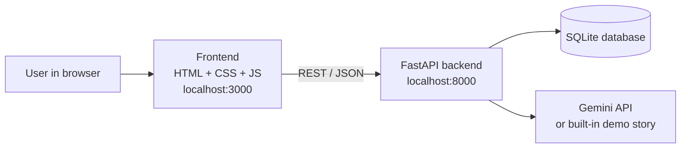
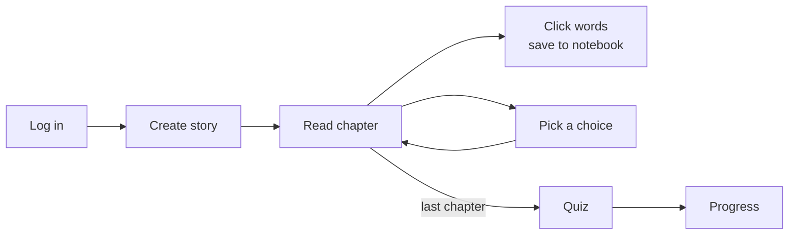
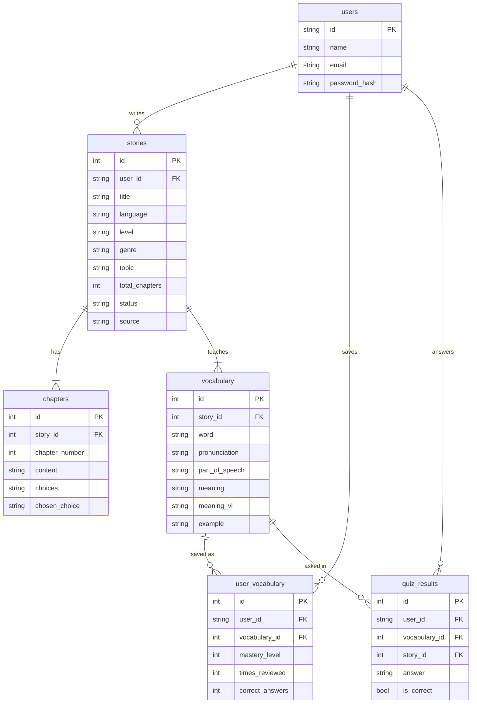

# Architecture

## Big picture

The browser never talks to the database or the AI directly. `frontend/api.js` is the only file that calls the backend.

## Main flow

## Database

Mastery rules (`routes/quiz.py`): correct answer **+20** (max 100), wrong answer **−10** (min 0). A word counts as *mastered* from 60.

## API

Open http://localhost:8000/docs for the interactive version.

| Method | Endpoint | What it does |
|---|---|---|
| POST | `/auth/register` | Create an account |
| POST | `/auth/login` | Log in |
| POST | `/stories/generate` | AI writes chapter 1 + vocabulary |
| POST | `/stories/{id}/next-chapter` | AI writes the next chapter from the reader's choice |
| GET | `/stories/{id}` | Open a story again (all chapters + vocabulary) |
| GET | `/stories/history/{user_id}` | List a user's stories |
| POST | `/vocabulary/save` | Save a word to the notebook |
| GET | `/vocabulary/user/{user_id}` | List saved words |
| GET | `/quiz/story/{id}` | Quiz questions built from the story's words |
| POST | `/quiz/submit` | Check an answer, update mastery |
| GET | `/dashboard/{user_id}` | Statistics, words and stories for the Progress page |

## How the AI is used

`backend/ai_engine/prompts.py` builds two prompts:

1. **Chapter 1**: settings (language, level, genre, topic, number of words) → JSON with title, text, 3 choices and the vocabulary (pronunciation, English and Vietnamese meaning, example)
2. **Next chapter**: the story so far + the reader's choice + the vocabulary list → JSON with the new text and choices (none on the last chapter)

Sending the whole story so far keeps characters and plot consistent. The answer is JSON-validated with Pydantic (`ai_engine/schemas.py`); if anything is wrong, `services/story_service.py` falls back to the demo story so the app never breaks during a demo.
