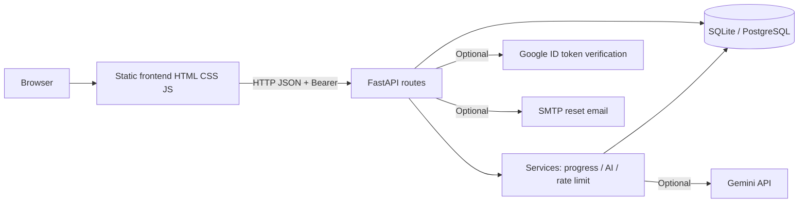
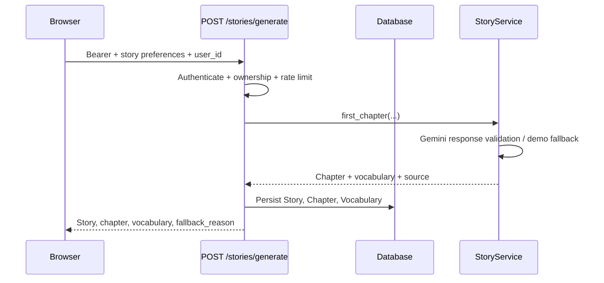

# Kiến trúc hệ thống

## Tổng thể

## Cấu trúc trách nhiệm

| Thành phần | Trách nhiệm | File |
|---|---|---|
| UI | Render màn hình, sự kiện, theme, navigation | `frontend/index.html`, `app.js`, CSS |
| API client | Gửi HTTP, bearer token, xử lý lỗi và timeout | `frontend/api.js` |
| App entry | Lifespan, CORS, router, health | `backend/app/main.py` |
| Routes | Validation và nghiệp vụ HTTP | `backend/app/routes/*.py` |
| Security | Xác minh token và quyền sở hữu | `backend/app/security.py` |
| Database | Engine, session, tạo bảng, thêm cột tương thích | `backend/app/database.py` |
| AI engine | Prompt và Pydantic response schema | `backend/ai_engine/*.py` |
| AI service | Client Gemini, parse, validate, fallback demo | `backend/app/services/story_service.py` |

## Luồng tạo truyện

## Ranh giới tin cậy

Frontend không được xem là nguồn phân quyền. Backend xác minh Bearer token và `user_id` ở dependency `protect_learning`; admin router sử dụng `admin_user`. Token phiên được lưu dưới dạng SHA-256 digest trong database. Cấu hình Gemini, Google và SMTP nằm ở server, không nhúng secret vào JavaScript.

## Quyết định kỹ thuật

- Frontend static giúp triển khai demo đơn giản nhưng không có build pipeline hoặc type-check JS.
- SQLModel giảm boilerplate nhưng `create_all` + `ALTER TABLE` không thay thế migration được quản lý phiên bản.
- AI fallback tăng khả năng demo khi mất quota nhưng cần hiển thị rõ nguồn demo.
- SQLite phù hợp local; PostgreSQL phù hợp hơn khi cần nhiều kết nối và vận hành lâu dài.
